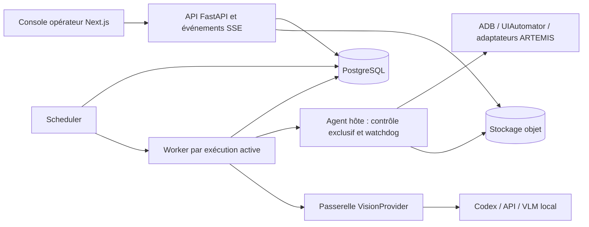
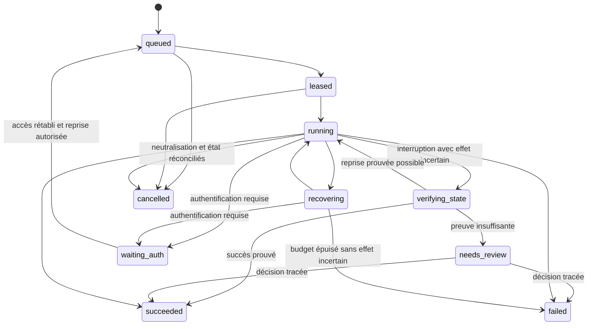

# Emulytix × Google ARTEMIS — Plan de réalisation

Date : 5 novembre 2026.  
Statut : catalogue et runs persistants livrés ; worker local et WF01 vérifiés sur un émulateur. Les jalons complets S1/S2/S3 restent ouverts.
Référence prioritaire : [study_v2.md](study_v2.md), dont le contenu correspond à la **v3 consolidée**.  
Périmètre de cette intervention : validation du plan avec les skills installées, correction du séquencement et début d'implémentation des contrats et de la persistance.

## 1. Besoin compris

Faire évoluer Emulytix vers une plateforme permettant à un opérateur de sélectionner des appareils Android physiques ou émulés, lancer un workflow sur un lot, suivre chaque exécution, arrêter le traitement et reprendre les échecs sans répéter un effet métier incertain.

La livraison cible couvre **trois workflows courts et déterministes**, chacun comportant moins de quinze étapes. Le chemin nominal utilise des scripts et des assertions. La vision LLM servira à récupérer une situation inattendue, avec un budget limité par étape et par exécution. Le catalogue et les runs persistants sont livrés ; une deuxième tranche exécute maintenant WF01 sur un émulateur avec vérification du résultat métier.

La trajectoire est progressive : un physique et un émulateur, puis 10–20 exécutions simultanées sur plusieurs hôtes, enfin des essais à 25, 50 et 100 appareils actifs. Le calendrier indicatif reprend trois sprints de deux semaines avec deux développeurs Backend/Runtime, un développeur Frontend et un référent Infra/Exploitation. Il dépend des accès, du matériel et des parcours disponibles.

L'utilisateur a confirmé que la base Android visée est **[Google ARTEMIS](https://github.com/google/artemis)**. Emulytix conserve la responsabilité du produit, des contrats API, de la persistance et de l'exploitation ; les composants Android utiles d'ARTEMIS seront intégrés dans un fork interne patché.

## 2. État constaté et écart avec la cible

Ce tableau décrit l'état de référence avant la première tranche. Les validations historiques mentionnées dans `technical-status.md` ne constituent pas des preuves pour la nouvelle implémentation ; ses vérifications seront consignées dans le suivi.

| Domaine | Présent dans les sources | Travail nécessaire |
|---|---|---|
| API | FastAPI, sessions, APK, commandes Android, captures, chat | Contrats devices/workflows/runs/executions, tâches asynchrones, droits d'accès |
| État | `SESSIONS` en mémoire dans `orchestrator-api/app/main.py` | PostgreSQL, migrations, journal durable, événements rejouables |
| Android | Runtime global, commandes ADB sans sélection systématique du serial | Inventaire par hôte, adressage explicite, autorité d'exécution par device |
| Agent | `agent-service/app/main.py`, plan via clé API, fallback heuristique | Workflows scriptés, récupération visuelle bornée, interface `VisionProvider` |
| Exécution | Boucle d'actions dans la requête HTTP de chat | Workers séparés, baux, fencing, supervision et reprise |
| Interface | Next.js, conversation, viewport Android, APK et commandes | Console opérateur : parc, lots, progression, revue et relance |
| Fichiers | Stockage local des APK et captures | Stockage objet, contrôle d'accès, rétention, chiffrement et masquage |
| Déploiement | Compose et image all-in-one | Déploiement multi-hôtes et capacité mesurée |

À l'état de référence, le dossier ne contenait ni dépôt Git ni contrats de runs. Le dépôt Git et la branche `feature/persistent-runs` sont maintenant établis. Le catalogue, les migrations, les runs et le worker local disposent de tests. L'intégration ARTEMIS, l'allocation multi-hôtes complète, la récupération LLM et les SSE restent à réaliser.

Points documentaires à corriger pendant la réalisation : anciens liens `/home/slid/Emulytix`, indications contradictoires sur KVM et sur l'état de l'all-in-one. Le fonctionnement réel doit être mesuré sur l'hôte retenu.

## 3. Outillage installé avant rédaction

Installation utilisateur dans `/home/slid/.codex/skills`, vérification de 144 fichiers `SKILL.md` et de leurs noms distincts.

| Ensemble demandé | Source et version installée | Contenu |
|---|---|---|
| Ponytail | [DietrichGebert/ponytail](https://github.com/DietrichGebert/ponytail), `96608e078b2d5ea607c5c3b8b5a54d1c1fba6846` | 6 skills |
| Agent Skills d'Addy Osmani | [addyosmani/agent-skills](https://github.com/addyosmani/agent-skills), `301b02b12bff98e4688e6984af6556802322bbde` | 25 skills et ressources partagées |
| Graphify | [Graphify-Labs/graphify](https://github.com/Graphify-Labs/graphify), `16218bfc80d4ca2799734d045039f7ed1a5fa9fb` | Skill Codex, 8 références et CLI `graphifyy==0.9.103` |
| Humanizer | [blader/humanizer](https://github.com/blader/humanizer), `0ef9fe5bc3572734fd3ae6c448fe00a30cd5dcf0` | 1 skill |
| Designer Skills | [Owl-Listener/designer-skills](https://github.com/Owl-Listener/designer-skills), `9a6930cf84a822eb458624bd11c61aac5bbdf224` | Les 111 skills présentes dans ce dépôt |

Les références partagées d'Addy Osmani sont conservées dans `~/.codex/skill-support/` et les liens locaux concernés sont adaptés. Graphify utilise sa variante Codex officielle. Les hooks, adaptateurs de commandes des autres assistants et collections hébergées dans d'autres dépôts ne font pas partie de cette installation. Aucun graphe du projet n'avait été généré lors de l'installation.

Manifeste d'installation sur cette machine : `/home/slid/.codex/skill-support/emulytix-install-2026-11-05.json`. Les skills sont disponibles dans cette session. La validation applique la revue adversariale et la décomposition d'Addy Osmani, le cadrage et les états de Designer Skills, ainsi que Humanizer pour la rédaction. `PLAN.MD` regroupe le plan et sa liste de tâches, conformément au nom demandé.

Graphify conserve l'instantané AST initial du prototype et un graphe actualisé du runtime sous `graphify-out/`, exclu de Git. Le rapport précise les sources, empreintes et limites : relations dynamiques non prouvées et migrations SQL non modélisées par le parser installé. Aucun appel LLM externe n'a été utilisé. La revue du plan et du code a été effectuée par des agents distincts ; l'utilisateur a choisi de conserver cette revue sans autre modèle.

## 4. Décisions et prérequis

| Sujet | Position de départ | Décision ou preuve attendue |
|---|---|---|
| ARTEMIS | Dépôt `google/artemis` identifié ; commit `351ca8422f7b5b54e80a9c1ce03a222e02415b6b` audité statiquement | Valider ce commit comme base du fork ; choisir sa destination ; conserver licences et notices |
| Métier | WF01 Chrome → Wikipédia → recherche `football` défini fonctionnellement ; deux autres parcours ouverts | [Fiche WF01](docs/workflows/WF01-chrome-wikipedia-football.md), observation des sélecteurs et provisionnement Chrome ; définir WF02/WF03 |
| Inférence | Device Code envisagé, provider abstrait | Spike technique et avis de viabilité d'usage ; choix au Go/No-Go J3 |
| Secours | API payante ou VLM local | Au moins un provider de secours réellement fonctionnel avant le Go/No-Go |
| Exploitation | Plusieurs hôtes et parc mixte | Inventaire, accès ADB autorisés, KVM pour le banc d'émulation accélérée, budget et responsable |
| All-in-one | Fonction existante et besoin historique | Le conserver pour le développement/démonstration ; préciser le niveau de maintenance attendu, sans en faire le déploiement du parc distribué |
| Données | Rétention de 30 jours proposée dans l'étude | Confirmer durée, accès, régions de stockage, masquage et gestion des secrets avec le responsable métier |
| Capacité | Trois sprints et quatre rôles | Confirmer disponibilité ; recalibrer après le spike et les mesures Infra |

Le protocole `chatgptDeviceCode` et la lecture des limites sont documentés par OpenAI. Les fenêtres, plafonds, modèles accessibles et conditions applicables au service doivent être vérifiés avec les comptes et le contexte réels. Les nombres « 5 h / hebdo » de l'étude ne deviennent pas des constantes du logiciel. La documentation recommande les clés API par défaut pour l'automatisation ; la réussite d'une connexion ne tranche pas la viabilité du service commercial. Sources : [app-server](https://learn.chatgpt.com/docs/app-server), [authentification](https://learn.chatgpt.com/docs/auth).

Le pool de comptes reste optionnel après mesures ; il ne doit pas servir à contourner une restriction ou une limite d'usage. Le modèle retenu doit accepter les images et passer un essai de récupération réel. Aucun changement du catalogue de modèles existant n'est déduit de ce plan.

### Audit ciblé de Google ARTEMIS

Référence consultée : [`351ca8422f7b5b54e80a9c1ce03a222e02415b6b`](https://github.com/google/artemis/tree/351ca8422f7b5b54e80a9c1ce03a222e02415b6b). Licence principale [Apache-2.0](https://github.com/google/artemis/blob/351ca8422f7b5b54e80a9c1ce03a222e02415b6b/LICENSE) ; examiner aussi les notices des composants `third_party/`. Le projet déclare Python ≥ 3.12. Aucun démarrage d'ARTEMIS n'a été effectué pendant cet audit.

| Élément vérifié | Conséquence pour l'intégration |
|---|---|
| `artemis/runtime/device_pool.py` et `runtime/device_lock.py` | Pool et verrou local réutilisables ; le verrou fichier/PID ne fournit pas les baux distribués requis |
| `artemis/mcp/action_executor.py`, `McpActionExecutor` avec actuator injectable | Frontière existante à privilégier pour adapter les actions, avant toute réécriture du cœur |
| `artemis/drivers/android/adb_driver.py`, `AndroidAdbDriver` | Effets via `adbutils` et UIAutomator en plus du binaire ADB : contrôler tous ces canaux |
| `artemis/agents/flash/runner.py`, `FlashRunner` | Boucle VLM existante à adapter pour la récupération ; moteur déterministe Emulytix à construire |
| `artemis/llm/router.py` | Routage multi-provider existant, mais plusieurs appels le contournent |

Le profil Emulytix devra traiter explicitement ces chemins :

- Fallback Google dans [`FlashRunner`](https://github.com/google/artemis/blob/351ca8422f7b5b54e80a9c1ce03a222e02415b6b/artemis/agents/flash/runner.py), résumés visuels dans [`summarizer.py`](https://github.com/google/artemis/blob/351ca8422f7b5b54e80a9c1ce03a222e02415b6b/artemis/agents/flash/summarizer.py), compression dans [`memory/chunking.py`](https://github.com/google/artemis/blob/351ca8422f7b5b54e80a9c1ce03a222e02415b6b/artemis/memory/chunking.py).
- Préchauffage SDK avec appels réseau dans [`sdk/agent.py`](https://github.com/google/artemis/blob/351ca8422f7b5b54e80a9c1ce03a222e02415b6b/artemis/sdk/agent.py), avant même un run si une clé Google est disponible.
- Defaults Gemini des juges pixel/planner dans [`config/llm.py`](https://github.com/google/artemis/blob/351ca8422f7b5b54e80a9c1ce03a222e02415b6b/artemis/config/llm.py), et outils auxiliaires ajoutés par le runner. Leur activation dépend du profil et doit être maîtrisée.
- Credentials alternatifs `GOOGLE_API_KEY` et `GCP_API_KEY` dans [`config/settings.py`](https://github.com/google/artemis/blob/351ca8422f7b5b54e80a9c1ce03a222e02415b6b/artemis/config/settings.py). Supprimer seulement `GEMINI_API_KEY` ne suffit pas. Isoler les imports avant de retirer des dépendances Google.

L'acceptation S1 couvre le démarrage, les tâches de fond et les fallbacks : instrumentation des appels et restriction des sorties réseau pour démontrer zéro inférence nominale et zéro appel auxiliaire hors passerelle. Le graphe Pro, l'analyse vidéo et les rapports QA lourds restent désactivés dans le profil de livraison initial.

## 5. Architecture cible

| Composant | Responsabilité |
|---|---|
| API | Valider les demandes et les droits, figer le lot et la version, exposer les états et le contrôle |
| PostgreSQL | Source d'autorité pour runs, exécutions, baux, intentions, preuves et événements |
| Scheduler | Allouer selon capacité et disponibilité, avec `FOR UPDATE SKIP LOCKED`, sans piloter les devices |
| Worker | Sur l'hôte du device, interpréter les étapes, journaliser l'intention, vérifier les résultats et gérer la récupération |
| Agent hôte | Sérialiser les actions par device, contrôler epoch et échéance, superviser processus et sous-processus |
| Adaptateurs ARTEMIS | Réutiliser contrôle Android, observations et traces ; isoler le moteur de récupération |
| Passerelle vision | Détenir les identifiants providers, réguler les appels, imposer les budgets et normaliser les réponses |
| Stockage et supervision | Protéger les artefacts, appliquer la rétention, corréler logs et métriques |

Réutiliser FastAPI, Next.js, les fonctions APK et le viewport configurable. Introduire progressivement les composants nécessaires. Le choix de la file PostgreSQL évite d'ajouter un broker avant qu'un besoin mesuré le justifie.

Topologie initiale : le scheduler est central et déclenche les workers sur l'hôte propriétaire du device. Le watchdog supervise ainsi des processus locaux et leurs descendants. L'agent hôte reste l'autorité finale d'envoi. Un éventuel worker distant doit déléguer à un exécutant local soumis aux mêmes règles ; son arrêt distant ne prouve pas la neutralisation du device.

## 6. Contrats à stabiliser en S1

### API et événements

- `POST /devices` : déclarer une identité immuable (`device_id`, `host_id`, `serial`, `kind`). Une déclaration a le statut `registered` ; elle ne prouve ni la présence physique, ni l'autorisation ADB, ni la disponibilité. Une réémission identique retrouve l'entrée existante ; une identité différente sous le même identifiant provoque un conflit.
- `POST /workflows` : publier une définition validée sous une paire `workflow_id`/version immuable. Une réémission identique retrouve cette version ; une modification sous la même paire provoque un conflit. La validation structurelle ne remplace pas la validation du parcours métier.
- `POST /runs` : `workflow_id`, version, paramètres, liste figée de `device_id`, concurrence maximale et `idempotency_key` ; réponse `202` et `run_id`. Même clé et même demande : même run ; contenu différent : conflit explicite.
- `GET /devices`, `GET /runs/{id}` et détail des exécutions : états, progression, erreurs, preuves et capacité disponible.
- `POST /runs/{id}/cancel` : demande durable d'arrêt ; suivi jusqu'à neutralisation effective et traitement de toute action métier incertaine.
- `POST /runs/{id}/retry-failed` : nouvelles tentatives liées aux précédentes ; exclure les succès et les cas `needs_review` non résolus. Respecter le caractère idempotent de la demande de relance.
- `POST /executions/{id}/resolve-review` : décision opérateur tracée, avec preuve et auteur ; succès, échec ou autorisation d'une nouvelle tentative.
- SSE par run : identifiant durable, type, date, `run_id`, `execution_id`, `device_id`, `lease_epoch` et données minimales. Reprise par `Last-Event-ID` ; prévoir un resynchronisme explicite si le curseur a dépassé la rétention.
- Écrire changement d'état et événement dans la même transaction. Le contrat est partagé avec le frontend avant implémentations parallèles. Conserver OpenAPI/Swagger.

Dans la première tranche, les listes de devices, workflows et runs sont paginées, et les détails référencent les versions et identités déclarées. Les événements d'un run sont consultables en JSON avec pagination/curseur. Le transport SSE et son contrat de reconnexion restent à implémenter ensuite.

Les nouvelles routes exigent `Authorization: Bearer <token>`. Leur activation nécessite `EMULYTIX_DATABASE_URL` et `EMULYTIX_CONTROL_TOKEN` ; une configuration incomplète n'autorise pas un accès anonyme. Le jeton protège aussi les lectures et reste absent des réponses et journaux. Ce contrôle initial est propre aux nouvelles routes ; l'authentification et les rôles de l'ensemble du produit restent le lot S109.

### Données

Prévoir les migrations pour `hosts`, `devices`, `workflows` et versions immuables, `runs`, `executions`, `device_leases`, `action_journal`, `run_events` et métadonnées d'artefacts. Les secrets sont référencés par identifiant de coffre. Une tentative conserve son lien à la précédente et ses preuves.

Le bail est exclusif par `device_id`, avec propriétaire, hôte, expiration et epoch strictement croissant. Les mises à jour d'un ancien propriétaire sont refusées. La version du workflow et le lot ne changent pas pendant un run.

### Workflows et vision

Chaque étape décrit `id`, action autorisée, sélecteurs successifs, `timeout_ms`, assertion, `non_idempotent`, budget de récupération, actions admissibles en récupération et procédure de vérification après interruption. Les étapes avec effet métier déclarent une preuve observable et les conditions autorisant une nouvelle tentative.

`VisionProvider.analyze(screenshot, goal, context)` retourne une action typée et un indicateur de confiance. Une réponse LLM ne déclenche jamais directement une commande : validation des arguments, contrôle du bail, vérification des budgets et assertion après action sont obligatoires. La confiance seule ne constitue pas une preuve métier.

La récupération reste dans les actions admissibles de l'étape. Toute action avec effet métier suit le même journal d'intention et les mêmes preuves que le moteur scripté. Une soumission incertaine ne peut pas être rejouée par le LLM.

Fixer au contrat les limites d'appels par étape et par run, les délais et le comportement après épuisement. Compter chaque requête d'inférence réelle, y compris retries, résumés et appels auxiliaires conservés ; ne pas assimiler un tour Flash à un seul appel. La passerelle impose le plafond indépendamment des options de boucle d'ARTEMIS, dont un mode non borné ne doit pas neutraliser les limites Emulytix. Les workers n'ont pas de clé provider ; la passerelle permet l'API de secours tout en supprimant les accès Gemini implicites d'ARTEMIS. Une bascule de provider est tracée.

### États et reprise

Ce diagramme fixe le parcours principal. La table de transitions devra couvrir chaque timeout, perte de bail, perte d'hôte, annulation et erreur. `cancel_requested` est une intention durable distincte de l'état final. Une action incertaine passe par `verifying_state` puis éventuellement `needs_review`, même si un arrêt a été demandé. Une relance après revue crée une nouvelle tentative.

S101a/S105a a livré la transition `queued` → `cancelled`. La tranche locale ajoute `queued` → `running` → `succeeded`/`failed`/`cancelled`/`needs_review`. Un run actif reçoit une intention durable `cancel_requested` et une réponse `202` ; le worker confirme ensuite sa fin. Un propriétaire actif non confirmé interdit toute annonce de neutralisation. Un bail expiré ou une intention à effet incertaine conduit à la quarantaine, sans réallocation automatique.

L'état agrégé reste `running` pendant les exécutions actives ou le traitement d'un lot partiellement terminé ; une fois les exécutions terminées, `needs_review` est prioritaire, puis `failed`, `cancelled` et `succeeded`. Le statut `queued` reste une demande enregistrée ; seul un worker du bon hôte la prend en charge.

## 7. Garanties de commande et de reprise

1. **Un seul point d'envoi Android par hôte.** Toutes les commandes, y compris APK, chat, contrôles manuels et récupération ARTEMIS, passent par l'autorité hôte. Couvrir sous-processus ADB, appels `adbutils`, UIAutomator et outils auxiliaires ; un wrapper du seul binaire ADB serait incomplet. Restreindre aussi le contrôle interactif noVNC pendant un bail actif ; masquer un bouton dans le navigateur ne suffit pas.
2. **Cibler le bon device.** Associer `device_id` au serial et à l'hôte ; appliquer `adb -s <serial>` aux opérations concernées. Une reprise ne redémarre pas globalement le serveur ADB partagé. [Documentation ADB](https://developer.android.com/tools/adb).
3. **Fermer la fenêtre entre contrôle et envoi.** Sérialiser acceptation et lancement par device, vérifier epoch et échéance au dernier point de commande, borner les durées et suivre les sous-processus. Un contrôle PostgreSQL isolé avant un appel ADB ne suffit pas.
4. **Arrêter même en cas de partition réseau.** Le watchdog utilise une échéance locale conservatrice fondée sur le dernier renouvellement confirmé. Sans renouvellement, il refuse les nouvelles actions et neutralise le groupe de processus. Un redémarrage de l'agent hôte commence sans autorisation d'agir. La relation bail/heartbeat proposée est de trois intervalles, à mesurer et ajuster.
5. **Conditionner la réallocation.** L'expiration du bail ne prouve pas que l'ancien pilote est neutralisé. Exiger la confirmation de l'autorité hôte ou un mécanisme d'isolation vérifiable ; sinon mettre l'appareil en quarantaine. Une action déjà reçue par Android peut continuer à produire un effet : sa reprise exige une preuve métier.
6. **Journaliser avant l'action.** Persister l'intention et l'epoch, exécuter, puis enregistrer résultat et preuve. Une intention non confirmée reste incertaine. Le journal seul ne garantit pas un effet unique.
7. **Préserver les preuves avant la remise en état.** À la reprise, observer l'écran et rechercher la confirmation métier avant un `force-stop` ou autre remise en état susceptible d'effacer l'information. Si une remise en état préalable est indispensable, prévoir une preuve durable indépendante de l'écran.
8. **Rejouer seulement quand c'est justifié.** Effet confirmé : continuer ou terminer ; absence d'effet démontrée : réessayer selon la politique du workflow ; état indéterminable : `needs_review`. Le seuil de revue humaine ne peut pas justifier une répétition incertaine.

## 8. Backlog ordonné

Rôles : **BE** Backend, **RT** Runtime, **FE** Frontend, **INF** Infra/Exploitation, **MET** responsable métier. Chaque ligne est un lot ; les lots comportant plusieurs changements seront découpés en tâches de session lors de leur prise en charge. Leur critère de sortie reste commun et vérifiable.

### Première tranche — S101a/S105a, indépendante des parcours métier

Objectif : déclarer un appareil, publier une version de workflow, créer un run durable, le consulter et l'annuler tant qu'il reste en attente. Cette tranche avance sans P02/P03 avec des données synthétiques de banc explicitement identifiées. Les parcours réels, l'inventaire connecté, les appels LLM, les workers et les commandes ADB restent des étapes ultérieures.

S101a stabilise l'enveloppe des contrats et les deux états initiaux ; S105a réalise leur persistance PostgreSQL et les routes correspondantes. Ces sous-lots ne terminent ni S101 ni S105 dans leur périmètre complet. La définition d'un workflow et sa publication ne l'autorisent pas encore à agir sur un appareil.

| Tâche | Livrable | Vérification attendue |
|---|---|---|
| S101a-01 | Schémas de device déclaré et de version immuable de workflow | Champs invalides refusés ; réémission identique stable ; modification conflictuelle refusée |
| S101a-02 | Contrat de création/lecture du run, lot figé et états `queued`/`cancelled` | Lot vide ou dupliqué et références inconnues refusés ; versions et devices figés |
| S105a-01 | Migrations PostgreSQL reproductibles pour le catalogue, les runs, exécutions et événements | Installation vierge et réapplication vérifiées sur PostgreSQL ; données conservées après réouverture |
| S105a-02 | Activation explicite et authentification Bearer sur toutes les nouvelles routes | Configuration absente/incomplète et jeton invalide refusés ; jeton non renvoyé |
| S105a-03 | Création transactionnelle d'un run avec une exécution par device et événements durables | Soumissions concurrentes avec une clé identique sans doublon ; conflit si le contenu change |
| S105a-04 | Lectures paginées et détail des événements en JSON | Limites et curseurs validés ; lecture cohérente après redémarrage de l'API |
| S105a-05 | Annulation atomique des seuls lots en attente | Toutes les exécutions et l'état agrégé changent ensemble ; annulation répétée sans nouvel effet |
| S105a-06 | Documentation d'activation et exemple synthétique complet | Parcours déclaration → publication → création → lecture → annulation reproductible sans Android ni provider |

Checkpoint atteint : 79 tests sur PostgreSQL réel, compatibilité des sessions et d'OpenAPI vérifiée, puis parcours HTTP exécuté dans l'image Docker avec persistance après deux redémarrages API. Les preuves et limites figurent dans le suivi ci-dessous. Cela ne valide pas l'exécution Android de WF01.

### Deuxième tranche — S105b/S106a/S107a, worker local et WF01

Objectif : transformer un run en attente en exécution Android observable sur un hôte. Le moteur scripté établit le contrat du contrôleur ; l'adaptateur ARTEMIS devra satisfaire les mêmes gardes et tests lors de S104. Le profil actuel utilise ADB et UIAutomator sans inférence.

| Tâche | Livrable | Preuve |
|---|---|---|
| S105b-01 | Migration `002_execution_runtime.sql`, baux, epochs et journal d'actions | Tests PostgreSQL réels, rollback et refus des propriétaires obsolètes |
| S106a-01 | Worker local, verrou partagé par device et renouvellement | Claims concurrents, limite par run et epochs croissants vérifiés |
| S106a-02 | Watchdog monotone indépendant et mort du client ADB avec son parent | Tests de blocage de poll, interruption, timeout et mort réelle du parent |
| S106a-03 | Annulation active durable, quarantaine des états incertains et journal consultable | Routes authentifiées, `202` avant confirmation, refus de reprise d'un bail occupé expiré |
| S107a-01 | Driver validant toutes les étapes avant action, sélecteurs et assertions réels | Tests de prévalidation, ambiguïté, domaine autorisé et échec de transport |
| S107a-02 | WF01 version 1, 11 étapes, captures et observations corrélées | Deux runs `succeeded`, epochs 1 puis 2, recherche saisie dans Wikipédia et résultat vérifié |
| S107a-03 | Script de banc et profil Compose runtime | Démarrage d'un AVD neuf reproduit ; image worker et parcours API → émulateur testés |

Le journal d'intention précède les commandes à effet. Les commandes d'observation sont contrôlées par le même bail ; leurs résultats utiles figurent dans les preuves des étapes. Une observation échouée n'est pas présentée comme un effet métier incertain. Une sortie ADB non nulle après une commande à effet reste incertaine.

La vérification de bail est refaite en SQL au point de mutation et avant validation de la transaction. Les tests couvrent une expiration entre la prise de verrou et l'écriture, ainsi que des événements retardés ; un renouvellement tardif ne ressuscite pas le bail. Les runs saturés sont filtrés avant la sélection des candidats.

Périmètre démontré : un émulateur Android 10/x86_64 avec Chrome 74 préinstallé, puis répétition sur le même device. L'installation d'un APK neuf, Android 14, un device physique, la récupération LLM, le coffre, la résolution opérateur des quarantaines et l'exploitation distribuée restent à valider. Les conditions de premier lancement ont été relevées lors de l'exploration ; les deux runs finaux du worker utilisaient Chrome déjà initialisé.

### Préparation — avant les essais J1

| ID | Travail et livrable | Responsable | Dépendances | Critère de validation |
|---|---|---|---|---|
| P01 | Établir le dépôt Git de travail et un état de référence ; figer ARTEMIS, licence, dépendances et politique de patchs | RT | Accès dépôt | Sources et origine reproductibles, notices conservées |
| P02 | Décrire les trois workflows, leurs entrées, effets métier et vérifications ; choisir le premier parcours | MET + RT | Applications/APK et accès | Une fiche exploitable par workflow, avec preuve de succès et cas d'interruption |
| P03 | Préparer physique, émulateur, comptes de test, accès provider de secours et coffre | INF + BE | Matériel et accès autorisés | ADB et captures vérifiés sur les deux types ; accès de test disponibles |
| P04 | Fixer profils de charge, jeu d'essai, limites de récupération, critères de viabilité et budget plafond | BE + RT + INF | P02–P03 | Protocole de mesure reproductible et règle Go/No-Go écrite |

### S1 — une tranche complète sur physique et émulateur

| ID | Travail et livrable | Responsable | Dépendances | Critère de validation |
|---|---|---|---|---|
| S101 | Compléter les contrats API, données, workflow, événements et table des transitions pour l'exécution réelle | BE + RT + FE | S101a, P01–P02 | Exemples métier nominaux et erreurs partagés ; invariants et compatibilité documentés |
| S102 | Interface vision, adaptateur Codex et un secours API ou local fonctionnel | BE | P03, S101 | Même récupération visuelle réussie avec les deux providers ; action rejetée si réponse invalide |
| S103 | Spike d'inférence soutenu 48 h, quotas observés, latence, coût et analyse d'usage | BE + INF | P04, S102 | Rapport et choix au J3 ; bascule de secours démontrée si No-Go |
| S104 | Fork ARTEMIS minimal et profil contrôlé : LLM, résumés, mémoire, préchauffage, juges et outils auxiliaires | RT | P01 | Les chemins conservés passent par la passerelle, démarrage inclus ; sorties réseau non autorisées bloquées |
| S105 | Compléter PostgreSQL avec journal d'actions et état durable d'exécution | BE | S105a, S101 | Redémarrage API sans perte ; intentions d'action et résultats persistés transactionnellement |
| S106 | Autorité hôte minimale, baux locaux durables avec epoch, ciblage serial, exclusivité et annulation active | RT | S101, S104–S105 | Deux pilotes concurrents refusés ; contrôle manuel ne contourne pas le bail ; arrêt constaté |
| S107 | Exécuteur scripté et premier workflow complet avec assertions | RT | S102, S105–S106, P02 | Succès physique et émulateur sans LLM nominal ; pop-up injecté récupéré dans le budget |
| S108 | Console minimale : sélectionner, lancer, suivre, arrêter, ouvrir preuves et erreurs | FE | S101, S105 | Parcours opérateur complet avec erreurs et états d'attente visibles |
| S109 | Mesure USB/émulation, stockage objet, secrets, logs et contrôle d'accès minimal | INF + BE | P03, S101 | Budget chiffré ; captures accessibles selon droits ; secrets absents des journaux |

**Go/No-Go J3 :** sélectionner le provider sur des observations et une analyse d'usage. Si 48 h de mesure n'ont pas pu être réalisées ou si l'avis manque, le jalon reste ouvert ; le calendrier est ajusté. Un simple squelette de secours ne permet pas de conclure à une bascule immédiate.

**Sortie S1 :** S101–S109 vérifiés, un workflow sur les deux types de device, récupération démontrée, état durable et zéro appel LLM non routé sur les chemins testés. L'authentification, les rôles opérateur et l'accès aux captures sont traités avant une mise à disposition hors banc de test.

### S2 — plusieurs hôtes et résilience

| ID | Travail et livrable | Responsable | Dépendances | Critère de validation |
|---|---|---|---|---|
| S201 | Étendre les baux S1 au scheduler PostgreSQL multi-hôtes, à la concurrence par run/hôte et au renouvellement distribué | BE | Sortie S1 | Allocation sans doublon sous demandes concurrentes ; saturation placée en attente |
| S202 | Fencing complet, watchdog, échéance locale et quarantaine sur tous les canaux à effet | RT + INF | S106, S201 | Ancien epoch, partition réseau et restart refusés ; couverture ADB, `adbutils` et UIAutomator démontrée |
| S203 | Vérification après crash, préservation des preuves et revue humaine | RT + MET | S107, S202 | Crash avant/après effet réconcilié ; effet incertain jamais rejoué automatiquement |
| S204 | Porter les deux autres workflows et leurs procédures de reprise | RT + MET | P02, S203 | Trois workflows avec nominal, récupération et preuve métier vérifiés |
| S205 | Régulation vision et état `waiting_auth` avec sortie contrôlée | BE | S103, S201 | 429/auth expirée n'entraînent ni boucle incontrôlée ni conservation indue du bail |
| S206 | Résultats partiels, relance des échecs, revue et reconnexion SSE | FE + BE | S203–S205 | Aucune relance des succès ; revue auditée ; reconnexion retrouve état et événements |
| S207 | Banc 25–50 devices sur au moins deux hôtes, charge ADB et chaos | INF + RT | S202–S204 | 10–20 exécutions simultanées métier ; résultats documentés pour chaque incident |

**Sortie S2 :** crash `kill -9`, déconnexion USB, perte réseau, expiration d'accès vision et perte d'hôte testés ; aucun double effet observé sur le jeu d'essai, aucun pilotage concurrent. Cible de revue après crash inférieure à 30 %, sans réduire l'exigence de preuve. Un parc de 25–50 est mesuré et le matériel nécessaire à 100 est provisionné avant la dernière montée.

Le pool de sessions reste P1, uniquement si les mesures et conditions d'usage le justifient. Les filtres SSE avancés peuvent attendre S3.

### S3 — capacité, exploitation et livraison

| ID | Travail et livrable | Responsable | Dépendances | Critère de validation |
|---|---|---|---|---|
| S301 | Montée progressive 25 → 50 → 100 avec backpressure | INF + BE + RT | Sortie S2, parc disponible | Une heure à 100 devices réellement actifs selon le profil fixé, métriques et erreurs publiées |
| S302 | Perte d'hôte et retour en service | INF + RT | S202, S301 | Parc restant opérationnel ; devices de l'hôte perdu indisponibles/quarantinés jusqu'à retour ou transfert contrôlé |
| S303 | Rétention, masquage, chiffrement, coûts et alertes | BE + INF | S109, S301 | Purge effective, droits et masquage vérifiés ; coût mesuré ou estimation identifiée comme telle |
| S304 | Ergonomie opérateur, filtres et modèles de lancement | FE + MET | S206 | Pilotes accomplissent lancement, arrêt, revue et relance ; gain de temps mesuré |
| S305 | Packaging, sauvegarde/restauration, exploitation et dossier de livraison | INF + BE + RT | S302–S304 | Installation reproductible, restauration testée, procédures d'incident et limites documentées |

La cible de 100 n'est pas une condition déjà acquise en fin S2. Ce plan corrige la contradiction entre le banc S2 de 25–50 et l'exigence d'entrée S3 à 100 dans l'étude. La perte d'un hôte ne rend pas ses téléphones USB accessibles depuis un autre hôte par simple réallocation de bail.

### Ordre et parallélisation

Les contrats S101a et la persistance S105a peuvent démarrer immédiatement avec le banc synthétique. Le chemin d'exécution métier reste conditionné par P02/P03 : S101 → S102/S103 et S104/S105 → S106/S107 → S201/S202 → S203/S204 → S207 → S301/S302 → S305. Les baux minimaux existent en S1 ; S2 les étend à l'allocation distribuée et aux scénarios de panne complets.

Après les contrats, le frontend peut avancer avec des événements simulés pendant le travail runtime ; le banc Infra et le spike provider avancent en parallèle. Les migrations, modifications du contrôle hôte et changements de format de workflow sont coordonnés avant intégration. Les checkpoints sont les sorties S1/S2/S3 et le Go/No-Go J3.

Le runtime local est implémenté dans `orchestrator-api/app/worker.py`, `execution_store.py`, `android_driver.py` et `adb_child.py`, avec migrations versionnées. Le profil `docker-compose.runtime.yml` active le worker et désactive le contrôle Android historique de l'API. Les composants multi-hôtes, le provider et l'interface opérateur restent à intégrer dans les répertoires existants.

## 9. Validation et indicateurs

Les essais utilisent des comptes et données de test réinitialisables, une version figée des workflows, un mix de devices publié et un relevé des récupérations injectées. Les durées sont mesurées côté exécution ; un retour HTTP d'annulation ne prouve pas l'arrêt d'ADB.

| Mesure | S1 | S2 | S3 |
|---|---:|---:|---:|
| Complétion métier vérifiée, reprises comprises | ≥ 85 % | ≥ 90 % | ≥ 93 % |
| Exécutions sans intervention humaine | ≥ 75 % | ≥ 85 % | ≥ 90 % |
| Appels LLM en chemin nominal | 0 | 0 | 0 |
| Appels LLM moyens par exécution, récupération incluse | Mesurer | ≤ 3 | ≤ 2 |
| Allocation p95, demande acceptée → bail attribué | ≤ 2 s | ≤ 5 s | ≤ 10 s |
| Arrêt p95, demande → neutralisation constatée | ≤ 3 s | ≤ 5 s | ≤ 5 s |
| Neutralisation zombie p95, bail expiré → groupe de processus neutralisé | Mesurer | ≤ 10 s | ≤ 10 s |
| Temps opérateur économisé à parcours comparable | Référence manuelle | ≥ 50 % | ≥ 70 % |

Définir le dénominateur avant les essais : une exécution initiale par appareil, succès après ses tentatives liées sans double comptage, échecs et `needs_review` non masqués. Publier séparément les annulations demandées, exclusions, récupérations et tailles d'échantillon. Pour les appels LLM, conserver aussi le nombre par tentative et la somme par parcours initial. Les taux ne valent pas preuve sur une population plus large que le banc testé.

Exigences bloquantes : aucun double effet métier ni pilotage concurrent dans les scénarios de validation ; toute incertitude reste visible. Les mesures complémentaires couvrent 429, budgets épuisés, latence d'étape, quarantaine, erreurs par hôte, rétention et coût. La cible 429 < 2 % est évaluée sur un trafic et une durée explicités.

Matrice minimale : nominal sans accès réseau provider, pop-up inattendu, sélecteur disparu, budget épuisé, crash avant envoi/après envoi/avant confirmation, bail obsolète, perte de PostgreSQL, partition réseau, reboot hôte, concurrence manuel/worker, annulation en cours d'action et replay SSE après déconnexion. Vérifier aussi les droits sur les runs et captures, l'absence de secrets en logs et la restauration de l'état.

## 10. Infra, données et coûts

Les hypothèses de l'étude servent au banc : 3 Go RAM et 2 vCPU par émulateur, 15–20 téléphones par contrôleur USB, hôte d'émulation 128 Go/32 cœurs et éventuel GPU 24 Go. Elles ne sont pas des capacités garanties. Mesurer CPU, RAM, I/O, débit de captures et stabilité ADB ; expliciter la surallocation CPU si 25–30 émulateurs sont envisagés sur cet hôte.

Le budget fin S1 sépare achat/location des hôtes, téléphones, contrôleurs/hubs alimentés, réseau, stockage, GPU éventuel, énergie et inférence. Préciser le mix physique/émulation et le nombre de runs quotidiens. À l'hypothèse documentaire de 200 Ko par capture et 30 captures par run, compter environ 6 Mo par run avant réplication ; multiplier par volume journalier et rétention.

Captures privées avec chiffrement au repos et en transit, accès autorisé et durée limitée pour les liens de consultation. Masquer avant transmission au provider les zones définies comme sensibles lorsque le workflow le permet. Secrets injectés au dernier moment, jamais inclus dans le journal des actions, les erreurs ou les paramètres exposés à l'interface.

Logs JSON et métriques corrélés par run, exécution, device, hôte et epoch. Sauvegarder PostgreSQL et métadonnées, définir l'objectif de restauration, tester le redémarrage et la réconciliation des devices. Les stockages locaux du MVP ont une stratégie de conservation/import explicite ; les sessions actuellement en mémoire ne sont pas présentées comme un historique durable à migrer.

## 11. Migration et limites de périmètre

Introduire les nouveaux runs à côté des sessions existantes, puis faire converger les commandes vers le contrôle hôte commun. Tant que cette convergence n'est pas vérifiée, interdire leur utilisation concurrente sur le même appareil. Maintenir les parcours APK, captures et viewport via une couche compatible et documenter tout changement d'API.

Conserver le chat comme point d'entrée assisté ou outil opérateur ; le run métier sélectionne toujours un workflow validé et versionné. Une modification suggérée par l'IA ne remplace pas silencieusement la version d'un run actif.

Le multitenant avancé, l'éditeur généraliste de workflows, la génération autonome de scripts en production et la refonte du transport vidéo ne sont pas des livrables de ces trois sprints. Leur ajout demande un arbitrage de périmètre. Les droits d'accès et la protection du contrôle Android restent nécessaires au produit livré.

## 12. Checklist de suivi

- [x] Lire l'étude v3 et comparer la cible aux sources locales.
- [x] Identifier Google ARTEMIS à la suite de la précision utilisateur.
- [x] Installer et vérifier les cinq ensembles de skills demandés.
- [x] Rédiger `PLAN.MD` avec dépendances, critères de validation et risques.
- [x] Effectuer la revue structurelle : tranche indépendante du métier, catalogue d'entrée, états agrégés et distinction des baux S1/S2.
- [x] S101a-01 — Vérifier les schémas de devices déclarés et de workflows immuables.
- [x] S101a-02 — Vérifier les références, le lot figé et les deux états initiaux.
- [x] S105a-01 — Vérifier les migrations et la persistance sur PostgreSQL réel.
- [x] S105a-02 — Vérifier l'activation par configuration et la protection Bearer.
- [x] S105a-03 — Vérifier l'idempotence concurrente et l'atomicité de création.
- [x] S105a-04 — Vérifier les lectures paginées et les événements JSON après redémarrage.
- [x] S105a-05 — Vérifier l'annulation transactionnelle des seuls lots en attente.
- [x] S105a-06 — Rejouer l'exemple synthétique documenté et les contrôles de non-régression.
- [x] Définir le premier parcours fonctionnel : [WF01 Chrome/Wikipédia/football](docs/workflows/WF01-chrome-wikipedia-football.md).
- [x] S105b-01 — Ajouter les baux avec epoch et le journal d'actions durables.
- [x] S106a-01/02 — Vérifier le worker local, les gardes, les deadlines et la neutralisation du client ADB.
- [x] S106a-03 — Vérifier l'annulation active et la quarantaine sans reprise automatique.
- [x] S107a-01/02 — Exécuter WF01 deux fois via l'API et le worker, avec preuve de saisie et de résultat.
- [x] S107a-03 — Vérifier le script de banc et le packaging Docker du worker.
- [ ] Décrire les trois workflows et leurs preuves métier (P02).
- [ ] Valider les accès, appareils et le protocole de mesure (P03–P04).
- [ ] Figer les contrats et la référence du fork (P01/S101).
- [ ] Trancher le provider et démontrer le secours au J3 (S102–S103).
- [ ] Atteindre et documenter la sortie S1.
- [ ] Atteindre et documenter la sortie S2.
- [ ] Atteindre et documenter la sortie S3.

Les cases de réalisation restent ouvertes jusqu'à production des preuves correspondantes. La rédaction de ce plan ne valide ni le fonctionnement Android actuel, ni la capacité à 100 devices, ni les conditions commerciales d'un provider.

### Preuves de la tranche S101a/S105a — 5 novembre 2026

- `.venv/bin/python -m pytest orchestrator-api/tests -q` : **79 tests réussis**. PostgreSQL 17 dans un conteneur éphémère, schéma distinct par test ; aucune connexion aux bases des stacks existantes.
- Huit soumissions concurrentes avec une clé identique donnent un seul run, une exécution par appareil et un seul événement de création. Un contenu différent pour une clé existante renvoie `409`, avant vérification de nouvelles références.
- Annulations concurrentes : un seul événement d'annulation. Des fautes injectées à l'écriture des événements démontrent le rollback commun des runs, exécutions et événements.
- Migrations réapplicables avec contrôle d'empreinte ; redémarrage API sans perte ; métadonnées immuables ; protection Bearer et erreurs de validation vérifiées, y compris bornes SQL et JSON incompatible avec PostgreSQL.
- Mutation de la comparaison d'idempotence dans une copie temporaire : le test ciblé échoue comme attendu ; le code du workspace conserve son empreinte. Preuve locale : `/tmp/emulytix-idempotency-mutation.json`.
- Image `emulytix-api:runs-foundation` construite. Huit contrôles HTTP réels réussis sur réseau et PostgreSQL éphémères : migration, démarrage, authentification, catalogue, création/lecture, idempotence après redémarrage, annulation et événements après un second redémarrage. Preuve locale sans secrets : `/tmp/emulytix-container-smoke.json`.
- Configurations Compose historique et profil `runs`, compilation Python et absence d'erreurs de diff vérifiées. Les avertissements de dépréciation FastAPI/TestClient existants restent visibles ; aucun changement du frontend n'a nécessité de build UI.

Les contrats de cette tranche portent sur des métadonnées. Les arguments d'actions, sélecteurs et assertions devront être validés pour le moteur réel avant exécution. Les paramètres de banc sont persistés en PostgreSQL ; le coffre et l'injection de secrets ne sont pas encore implémentés. Les nouvelles routes sont protégées par un jeton partagé ; les anciens endpoints ne sont pas encore couverts par cette protection.

### Preuves de la tranche locale — 5 novembre 2026

- Suite finale : **153 tests réussis** avec `.venv/bin/python -m pytest orchestrator-api/tests -q`. Les tests utilisent PostgreSQL éphémère et de faux exécutables ADB pour les interruptions ; les fixtures UI proviennent du banc réel.
- Parcours complet exécuté avec l'image `emulytix-worker:wf01`, empreinte `sha256:2cc1da858d888c1ff235d52371b031806a6f79f51a67ba98dc00fdd1304ba00f`.
- Run `295d6d4d-8627-40bc-9c8e-c02e8d550b12`, epoch 1, puis `e4d9106b-be6e-4af3-991f-d18e6449732a`, epoch 2 : **11 étapes, 8 actions à effet confirmées et 19 événements contigus par run**, résultat `succeeded`.
- Le terme `football` est observé dans le champ de recherche de Wikipédia avant soumission. Le résultat affiche `firstHeading=Football`, Chrome au premier plan et `https://fr.wikipedia.org/wiki/Football` dans la barre d'adresse. Le scénario n'ouvre pas directement l'article final.
- Zéro intention en suspens, bail libéré, device non quarantiné. Replay des événements par pages de cinq, curseur final vide. Aucune réinstallation de Chrome présent et zéro appel LLM dans ce profil dépourvu de provider.
- [Rapport local](storage/wf01-worker/validation.json), [capture de saisie](storage/wf01-worker/run-1-query-entered.png), [capture du résultat](storage/wf01-worker/run-1-result.png). Les artefacts sont conservés localement, hors Git.
- Configuration Compose historique/runtime, compilation Python, syntaxe du script de banc et diff vérifiés. Le banc de validation est éphémère et les services déjà présents sur l'hôte n'ont pas été modifiés.

Limites : les paramètres ne sont pas encore interpolés ; WF01 contient sa recherche explicitement. Le profil ADB actuel accepte les commandes de navigation prévues et du texte ASCII. Les APK doivent être approuvés hors du worker avec signature/ABI vérifiées ; le driver contrôle le répertoire autorisé et SHA256. L'interface opérateur, les SSE, le fork ARTEMIS et le provider de récupération restent des tâches ouvertes ; cette livraison ne valide pas la sortie S1 complète.

### Consultation locale des preuves — 6 novembre 2026

Une page `/validation` dans `web-ui` présente les deux runs archivés et leurs captures réelles. Le profil autonome `docker-compose.preview.yml`, projet `emulytix-preview`, l'expose sur `http://localhost:3100/validation` avec le seul dossier de preuves monté en lecture seule. L'accueil historique comporte un lien vers cette page. Cette vue ne lance pas de run et ne constitue pas la console opérateur S108 ; elle distingue les preuves enregistrées de l'état actuel de l'émulateur. Les routes autorisent uniquement les quatre PNG connus et une projection du rapport, sans accès général au stockage.

Vérification : cinq tests de lecture/projection/confinement des preuves réussis ; build Next.js en production réussi ; navigation Chromium aux largeurs 320, 768, 1024 et 1440 px sans débordement de page, quatre images chargées, détails au clavier, lien d'agrandissement et rapport JSON vérifiés. Aucun échec réseau ni erreur console sur cette page. Compte rendu et captures de la vue dans `storage/site-preview/`. Le verrouillage npm et un correctif PostCSS de la même version majeure permettent un audit sans vulnérabilité signalée au moment de ce contrôle.
