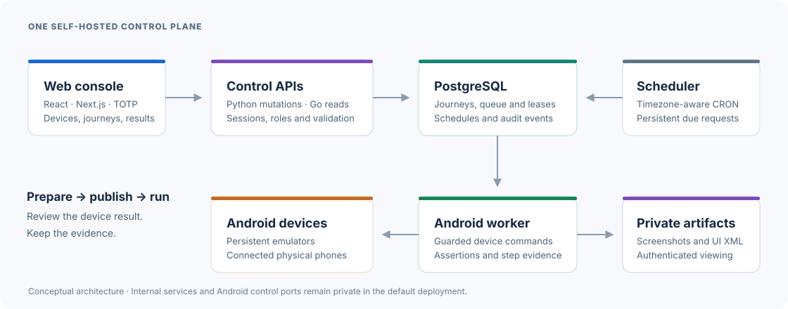
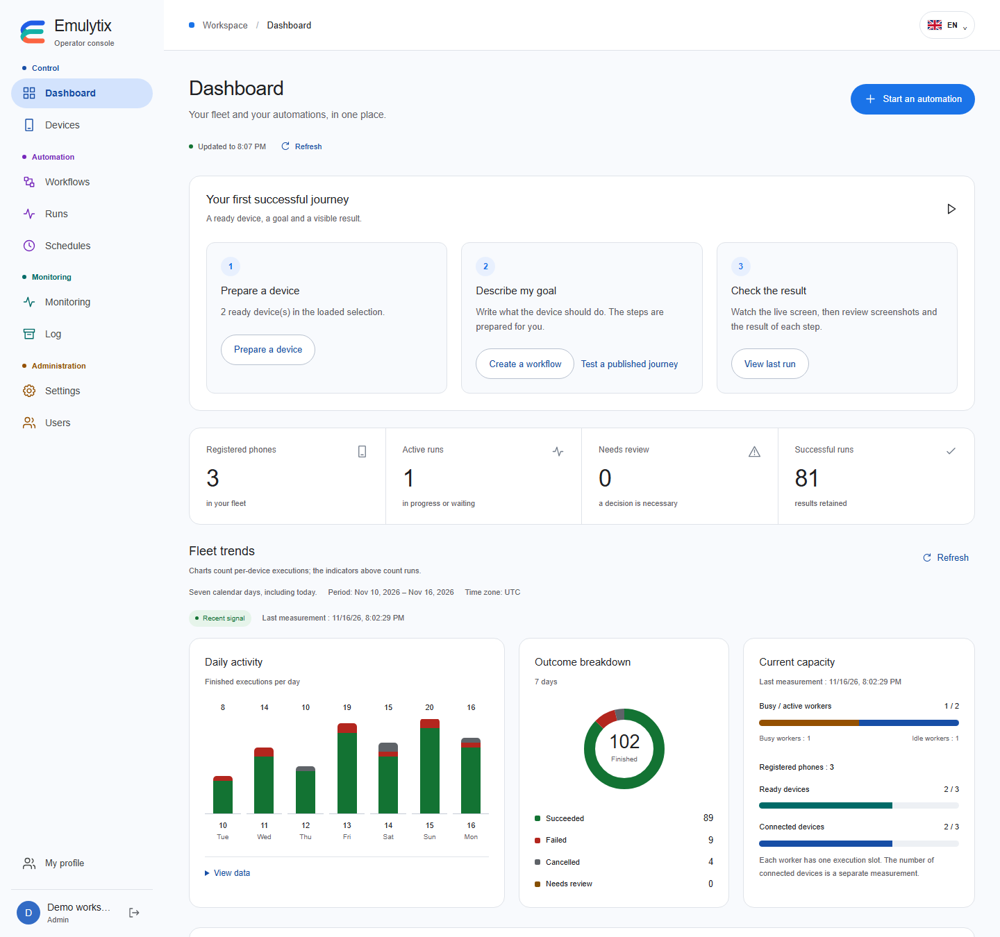
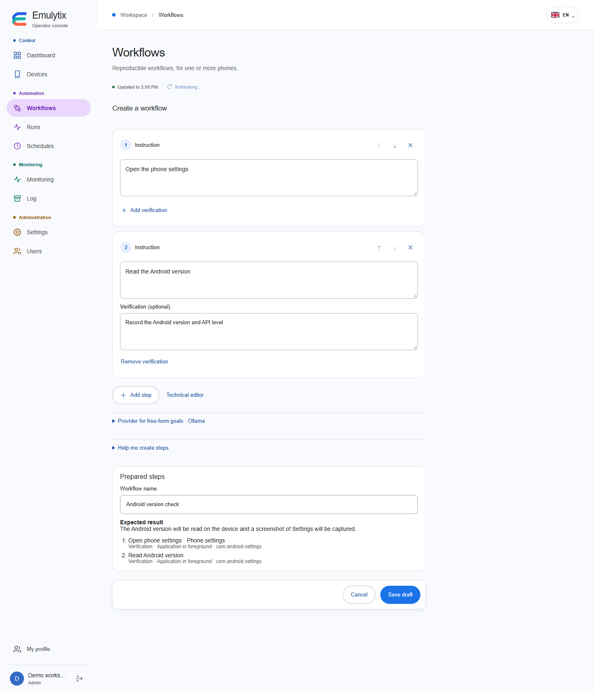
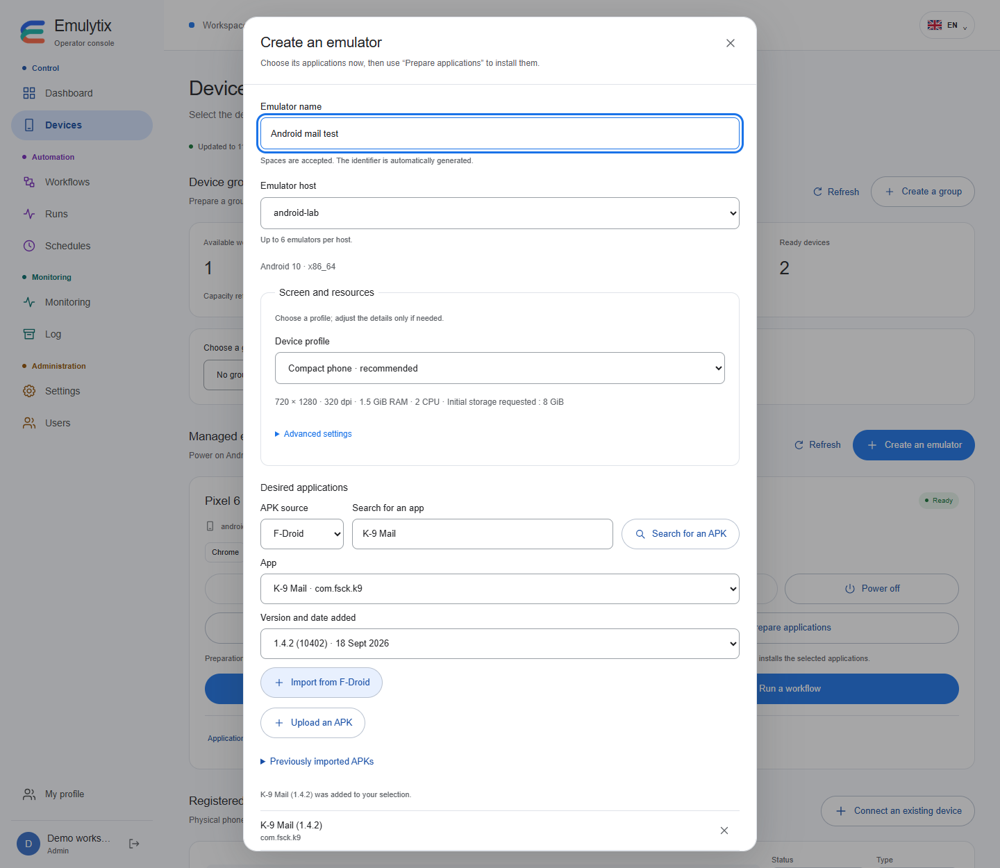
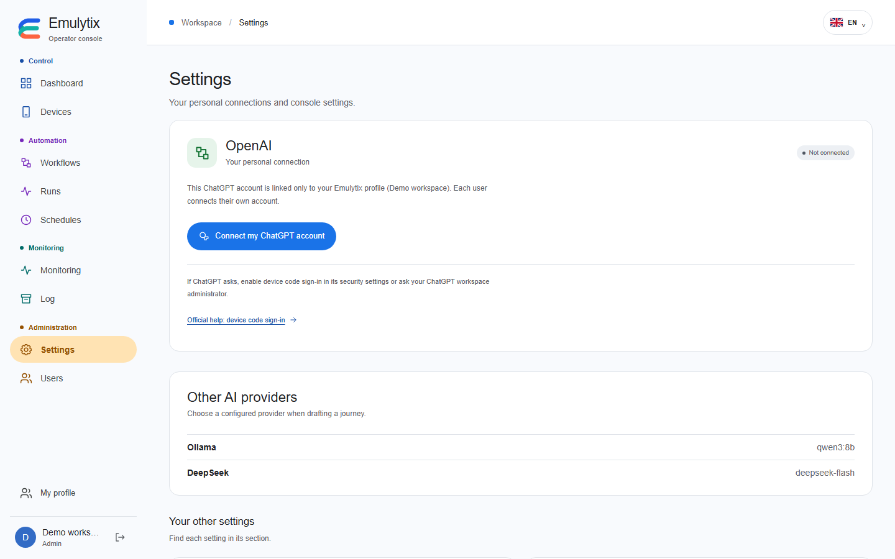
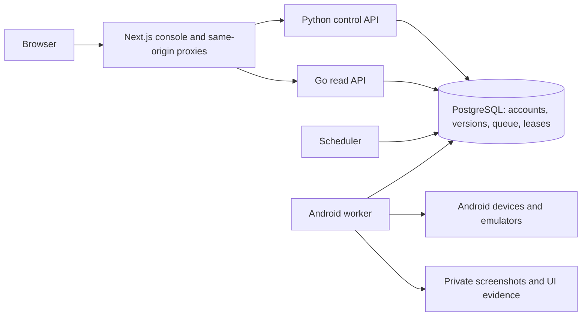

<p align="center">
  
</p>

<h1 align="center">Emulytics</h1>

<p align="center">
  <strong>Prepare Android devices. Describe a journey. See the result.</strong>
  <br>
  A self-hosted control console for persistent emulators, versioned automation and execution evidence.
</p>

<p align="center">
  <a href="https://github.com/drslid/Emulytics/actions/workflows/ci.yml"></a>
  
  
  
  
  <a href="LICENSE"></a>
</p>

<p align="center">
  <a href="https://drslid.github.io/Emulytics/">Documentation</a> ·
  <a href="https://drslid.github.io/Emulytics/getting-started/install/">Installation</a> ·
  <a href="https://drslid.github.io/Emulytics/getting-started/first-journey/">First journey</a> ·
  <a href="https://drslid.github.io/Emulytics/reference/security/">Security model</a>
</p>

> [!IMPORTANT]
> Emulytics is an early self-hosted release. The reproducible local runtime is Android 10 / API 29 on Linux x86_64 with KVM. iOS and universal third-party application automation are not included. Review the [current scope](https://drslid.github.io/Emulytics/project/status/) before deployment.

## Quick install

You need:

- Linux x86_64 with hardware virtualization and accessible `/dev/kvm`;
- a local Docker Engine, the Docker Compose plugin, Git, Bash and Python 3;
- at least 8 GiB RAM, including 4 GiB available at startup;
- at least 25 GiB free disk space for images, dependencies and Android data.

```bash
git clone https://github.com/drslid/Emulytics.git
cd Emulytics
./scripts/install.sh --accept-android-license
```

The flag confirms acceptance of the [Android SDK terms](https://developer.android.com/studio/terms). Docker and Compose must already be installed. The first build downloads the verified Android archives and builds the local application images.

If Linux or a VM exposes less than 8 GiB total RAM, the installer reports the detected amount. Increase the guest's allocation or explicitly accept reduced capacity with `--allow-low-memory`; at least 4 GiB must still be available. You can verify this first with `./scripts/install.sh --check --allow-low-memory`.

The installer:

1. checks the host, local Docker engine, KVM, memory and free storage;
2. creates private configuration only if it is missing;
3. builds the Android runtime from official archives verified by SHA-256;
4. applies migrations and starts the console, APIs, PostgreSQL, scheduler and worker;
5. prepares a private local Android emulator without replacing existing user data.

Open **http://localhost:3100**. Retrieve the generated initial access in a private terminal:

```bash
./scripts/account.sh initial-access
```

Sign in as `admin`, replace the temporary password, enroll an authenticator application and save the recovery codes. Re-running installation does not reset enrolled accounts.

**Detailed procedure:** [Installation](https://drslid.github.io/Emulytics/getting-started/install/) · [First sign-in](https://drslid.github.io/Emulytics/getting-started/first-sign-in/)

## Update Emulytics

The console checks for newer stable releases on GitHub. An administrator can install a detected version from **Settings → Updates** on a host with the local updater enabled. The console restarts during installation and reports the result when it comes back.

The Linux installer enables the updater when a systemd user session is available. If you installed a version from before the update feature, bring the existing checkout to a stable release and rerun the installer once. [Update instructions](https://drslid.github.io/Emulytics/getting-started/install/#update-emulytics) · [GitHub releases](https://github.com/drslid/Emulytics/releases)

## What Emulytics is

Emulytics combines a React/Next.js console, a Python control API, selected Go read APIs, PostgreSQL-backed execution queues and a guarded Android worker. It separates device preparation, journey creation and execution so that each launch has a version, an explicit device selection and inspectable evidence.

<p align="center">
  
</p>

The console and environment variables retain some **Emulytix** names, including the `EMULYTIX_` prefix. The public repository and documentation use **Emulytics**; do not rename configuration variables when installing.

### Included

- Persistent Android emulators with screen, density, RAM, CPU and initial-storage settings.
- Physical Android registration, named device groups and selected bulk actions.
- Application preparation with standalone APKs from F-Droid, Aptoide or local uploads, APKMirror search, and optional installation of the latest signed Aurora Store release. Chrome comes from the runtime image.
- Editable workflow cards in plain language, with built-in reference journeys and optional help from OpenAI, local Ollama or DeepSeek.
- Editable drafts, immutable publications and removal of unused published versions with historical evidence retained.
- Immediate launches, daily/weekly/monthly scheduling and advanced five-field CRON with explicit timezones.
- Live screens during active executions, step screenshots, observed device results and controlled retries.
- Dashboard charts, an observed component map, metrics and a searchable audit journal.
- Five local roles, mandatory password replacement and TOTP enrollment, and personal account security.
- Scoped personal REST keys and a local stdio MCP adapter.
- English, French, Simplified Chinese, Hindi, Spanish, Portuguese, Arabic, Russian, Bengali and German in the console.

## Console screenshots

These screenshots show the Emulytics console with demonstration data.



<details>
<summary>Workflow cards, APK search and AI provider settings</summary>







</details>

## Run your first journey

1. Open the dashboard's **Your first successful journey** assistant.
2. Select a device whose Android connection and required applications are ready.
3. Write `Open the phone settings` in the first card and `Read the Android version` in the next one.
4. Prepare the cards, review the actions, save the draft, then publish and test it.
5. Open the execution to inspect the observed version and step screenshots.

A Wikipedia reference goal also works without an external account:

```text
Open Chrome, go to Wikipedia, search for football and verify the article.
```

The Android version and Wikipedia reference goals use built-in rules and templates. They run without an external account or language model. For other supported journeys, you can describe the whole task and ask your configured AI provider to suggest cards. In **Settings → AI providers**, an administrator sets the installation-wide default provider, saves a shared DeepSeek API key, or configures a local Ollama server and model. Open a provider and choose **Test connection** to verify its saved configuration. Each user connects and tests their own OpenAI account.

Generated steps stay within the driver's supported actions. Review the draft, then publish and test it on a device.

**Detailed procedure:** [First journey](https://drslid.github.io/Emulytics/getting-started/first-journey/) · [Journey lifecycle](https://drslid.github.io/Emulytics/guides/journeys/) · [AI providers](https://drslid.github.io/Emulytics/guides/configuration/) · [Execution evidence](https://drslid.github.io/Emulytics/guides/executions/)

## Prepare a device

In **Devices → Create an emulator → Desired applications**, one search checks F-Droid, Aptoide and APKMirror. Choose a release by version and date. F-Droid and Aptoide results can be imported in the console. For APKMirror, open the release page, download a standalone APK compatible with Android 10 x86, and upload it in the form. Select **Install Aurora Store** to add the latest stable, signed build from [Aurora OSS](https://auroraoss.com/files). **Prepare applications** installs the selected APKs.

Use **Prepare applications** to install the selected APKs on the emulator. **Power on** starts Android and **Power off** stops it while preserving its data.

Register an existing phone or emulator with its worker host and exact ADB serial. A device name alone does not establish an Android connection.

From **Devices**, operators and administrators can rename devices or remove them from the inventory. Managed emulator controls also let them power Android on and off. Removal preserves historical runs and the stopped emulator's Android storage.

A worker process executes one journey at a time, and a device has one active execution at most. More workers and ready devices can increase concurrency within the host's actual resource limits. The maximum devices per request is not a measured capacity guarantee.

**Detailed procedure:** [Devices and emulators](https://drslid.github.io/Emulytics/guides/devices/) · [Schedules](https://drslid.github.io/Emulytics/guides/schedules/) · [Monitoring](https://drslid.github.io/Emulytics/guides/monitoring/)

## Architecture



The default deployment publishes only the web console on `127.0.0.1:3100`. PostgreSQL and Android control ports remain private. Only the trusted worker receives the Docker socket for managed-emulator operations.

The Go migration covers selected reads; Python remains part of the control plane. See [architecture and trust boundaries](https://drslid.github.io/Emulytics/reference/architecture/).

## Documentation

The public documentation lives at **[drslid.github.io/Emulytics](https://drslid.github.io/Emulytics/)**:

- [Install the complete local stack](https://drslid.github.io/Emulytics/getting-started/install/)
- [Manage devices and applications](https://drslid.github.io/Emulytics/guides/devices/)
- [Create, publish and remove journey versions](https://drslid.github.io/Emulytics/guides/journeys/)
- [Inspect executions and retry failures](https://drslid.github.io/Emulytics/guides/executions/)
- [Manage users and personal security](https://drslid.github.io/Emulytics/guides/users/)
- [Connect REST and MCP clients](https://drslid.github.io/Emulytics/reference/api-mcp/)
- [Troubleshoot a local installation](https://drslid.github.io/Emulytics/reference/troubleshooting/)

Repository policies: [Security reports](SECURITY.md) · [Contributions](CONTRIBUTING.md) · [License](LICENSE) · [Third-party notices](NOTICE).

GitHub Pages hosts documentation only. It does not expose a running console, Android devices, databases or local execution captures.

## Development

The active components are:

```text
web-ui/            Next.js/React console and same-origin API proxies
orchestrator-api/  Python API, authentication, stores, scheduler and worker
console-api-go/    Go summary, fleet and dashboard reads
android-runtime/   Reproducible Android runtime and scripts
workflows/         Bundled deterministic journey versions
scripts/           Installer, local account tools and MCP adapter
docs-site/         Astro/Starlight public documentation
```

Use the committed dependency locks and the [contribution guide](CONTRIBUTING.md) to prepare a development environment. API tests use disposable PostgreSQL containers and require Docker. From `docs-site/`, run the documentation locally with:

```bash
npm ci --ignore-scripts
npm run check
npm run build
npm run dev -- --host 127.0.0.1
```

## Security and scope

- The first password must be replaced and TOTP is mandatory.
- Server-side roles, origin checks and scoped keys protect actions independently of interface controls.
- Five roles operate in a shared workspace; customer-tenant isolation is not implemented.
- Live screens and captures require authenticated access and can contain private application data.
- Password, factor and provider credentials belong to the installation's private configuration and database.
- The Docker-enabled worker is a trusted host component, not a sandbox for arbitrary code.
- Keep `.env.console`, API keys, recovery codes, provider tokens and populated data volumes out of version control.
- Preserve the environment's encryption key with consistent backups; do not remove volumes as a troubleshooting shortcut.

The current runtime is Android 10 / API 29 with its provided Chrome. iOS, split APK bundles, Play Store installation, general social-app automation and resizing initialized Android storage are outside this release. Live provider connections, broad physical-device compatibility, large-fleet load and full backup/restore validation require separate verification.

## License

Original Emulytics code is available under [Apache-2.0](LICENSE). Third-party dependencies, resources, Android archives and application packages retain their own licenses and terms; see [NOTICE](NOTICE).
