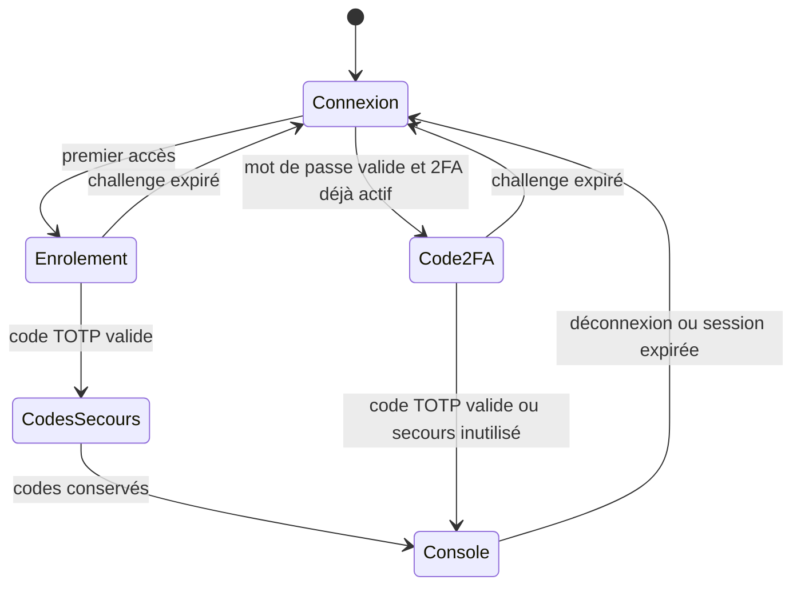

# Emulytix : console de contrôle du parc Android

Étude et première implémentation du 6 novembre 2026. Demande : remplacer entièrement l'interface de démonstration par une console simple, claire, inspirée des outils Google, capable de gérer plusieurs téléphones et protégée par mot de passe et 2FA.

## Besoin retenu

L'opérateur doit pouvoir répondre rapidement à trois questions : quels téléphones sont déclarés ou occupés, quelles tâches avancent et où faut-il intervenir ? Le parcours principal est choisir une automatisation, sélectionner un lot explicite de téléphones, vérifier les cibles puis suivre les résultats. Les preuves historiques restent consultables, sans se faire passer pour une activité en direct.

Le périmètre est un espace de travail commun aux comptes autorisés. Plusieurs comptes et téléphones sont possibles ; les rôles fins et l'isolation de plusieurs clients ne sont pas encore implémentés. Une déclaration d'appareil ne prouve ni sa connexion ni ses autorisations Android. L'interface affiche seulement les observations disponibles dans PostgreSQL.

Cette étude est une revue experte des besoins et des deux dépôts, suivie de tests techniques et visuels. Elle ne constitue pas une étude d'utilisabilité menée avec des opérateurs. Les choix pourront être ajustés après leurs premières sessions.

## Sources et parti pris

- L'[audit de MobileAgent](mobileagent-audit.md) distingue ses deux générations et les composants réellement réutilisables. On reprend les principes de sélection figée, de disponibilité explicite et de preuves horodatées, sans importer une seconde architecture ni ses données.
- [Material Design : navigation](https://m3.material.io/components/navigation-drawer/overview) et [rôles des couleurs](https://m3.material.io/styles/color/roles) servent de références de langage visuel. L'interface garde sa marque et ses composants ; aucun logo ou visuel Google n'est copié.
- [Authentification Next.js](https://nextjs.org/docs/15/app/guides/authentication) : vérification côté serveur et distinction authentification, session et autorisation.
- [OWASP : authentification multifacteur](https://cheatsheetseries.owasp.org/cheatsheets/Multifactor_Authentication_Cheat_Sheet.html) : second facteur avant accès, récupération et gestion des tentatives.

La palette devient claire : fond gris bleuté, surfaces blanches, texte sombre et accent bleu. Une bordure sépare les zones ; les ombres et couleurs décoratives sont limitées. Les statuts restent compréhensibles en noir et blanc grâce à leurs libellés. Les polices système évitent un téléchargement tiers à chaque connexion.

## Architecture de l'information

| Destination | Question de l'opérateur | Action principale |
|---|---|---|
| Vue d'ensemble | Que se passe-t-il et où intervenir ? | Ouvrir une activité ou lancer une exécution |
| Téléphones | Quels appareils puis-je cibler ? | Rechercher, sélectionner puis lancer sur le lot |
| Automatisations | Que puis-je faire exécuter ? | Choisir une version publiée |
| Activité | Où en sont mes exécutions ? | Consulter le résultat ou demander l'arrêt |
| Sécurité | Quel compte est connecté et comment fermer l'accès ? | Se déconnecter |
| Banc de validation | Qu'a réellement réussi WF01 lors du banc ? | Consulter les captures et le rapport archivés |

Les quatre premières destinations restent visibles dans la navigation principale. Le compte, la sécurité et le banc sont secondaires. L'ancienne interface de chat, les sélecteurs de modèles IA et les contrôles ADB directs disparaissent de la console : ils ne correspondent pas au travail quotidien demandé et le contrôle direct ne doit pas contourner le worker.

## Étude des éléments, écran par écran

| Élément | Décision et utilité | États et garde-fous |
|---|---|---|
| Marque | Emulytix, petit symbole simple ; aucun grand bandeau marketing | L'espace utile reste consacré au parc |
| Navigation | Libellés français stables, icône et état courant | Visible au clavier ; adaptation aux petits écrans |
| Titre de page | Nomme la tâche de l'écran | Un seul titre principal, sans jargon interne |
| Bouton principal | Une action cohérente avec la page | Désactivé avec explication si un prérequis manque |
| Compte | Identifiant courant et accès Sécurité | Aucune clé API ni jeton affiché |
| Déconnexion | Révocation serveur, puis retour à la connexion | Un simple effacement visuel ne suffit pas |
| Compteurs de synthèse | Comptes issus de toute la base | Une API indisponible n'est pas présentée comme zéro |
| Activités en cours | Accès direct aux exécutions actives | L'état « en attente » reste distinct d'« en cours » |
| Activités à vérifier | Remontent les situations nécessitant une intervention | Pas de relance automatique d'un effet incertain |
| Activité récente | Court aperçu lié au détail | Date et statut réels ; rien d'inventé pour remplir l'écran |
| Actualisation | Rafraîchissement périodique borné | Date de dernière mise à jour et erreur visibles |
| Liste des téléphones | Tableau aligné, adapté à plusieurs dizaines d'appareils | Défilement du tableau, pas de débordement de page |
| Recherche du parc | Recherche par identifiant, hôte ou numéro de série | Un résultat vide propose d'ajuster la recherche |
| Filtres | Disponibilité connue et type d'appareil | Le périmètre du filtrage et les pages restent explicites |
| Type d'appareil | Téléphone physique ou émulateur | Ne pas inventer modèle, batterie ou version Android |
| Disponibilité | Déclaré, occupé, à vérifier | « Déclaré » signifie connexion non vérifiée |
| Hôte et numéro de série | Permettent d'associer la cible au bon worker | Informations utiles à l'ajout et au diagnostic, pas des indicateurs de santé |
| Sélection multiple | Cases à cocher et nombre de cibles sélectionnées | Ne pas sélectionner silencieusement des appareils hors du périmètre visible |
| Action de lot | Lance la même version sur la sélection | La liste est figée avant soumission |
| Ajout d'un téléphone | Formulaire court de déclaration | Erreurs de validation et conflit d'identité expliqués ; pas de faux appairage |
| Catalogue | Versions d'automatisations déjà publiées | L'interface n'invente ni éditeur de script ni récupération IA |
| Étapes d'une automatisation | Présentation lisible avant lancement | La version affichée est celle envoyée au serveur |
| Choix des cibles | Sélection explicite dans le formulaire de lancement | Aucun appareil pris implicitement parce qu'il est le premier |
| Concurrence | Nombre maximal de téléphones traités à la fois | Borné au nombre de cibles ; les options restent secondaires |
| Récapitulatif | Automatisation, version, lot et concurrence avant envoi | Retour possible sans perdre la sélection |
| Soumission | Clé d'idempotence conservée lors d'un nouvel essai réseau | Un timeout navigateur ne doit pas créer un deuxième lot |
| Liste d'activité | Statut, automatisation, cibles et date | Filtre de statut et accès au détail |
| Détail d'exécution | D'abord le résultat de chaque appareil | Les identifiants internes restent secondaires |
| Étapes et erreurs | Assertions, résultat et étape en échec | Texte lisible ; pas d'exception serveur ou de secret brut |
| Journal | Événements chronologiques consultables à la demande | Données persistées ; l'actualisation n'est pas présentée comme un flux SSE |
| Arrêt | Confirmation puis intention d'annulation envoyée au serveur | « Arrêt demandé » jusqu'à confirmation ; gérer la réponse 202 |
| Captures | Preuves rattachées à une exécution et une étape | Accès authentifié, chemin confiné, empreinte vérifiée |
| Banc WF01 | Capture de la recherche et article obtenu, avec date du banc | Archive distincte des runs de la base actuelle |
| Formulaire de connexion | Identifiant et mot de passe avec autocomplétion adaptée | Erreur générique ; pas de compte public par défaut |
| Mot de passe | Saisie masquée, transmission au seul backend interne | Jamais conservé dans le stockage navigateur ou les journaux |
| Étape 2FA | Un champ à six chiffres, compatible collage et saisie mobile | Aucun accès au parc après le seul mot de passe |
| Premier enrôlement | QR et secret manuel, puis vérification d'un vrai code | Challenge limité à l'enrôlement ; pas encore de session complète |
| Codes de secours | Dix codes affichés une seule fois, possibilité de les télécharger | Chaque code consommé devient inutilisable |
| Code perdu/expiré | Retour possible au mot de passe ou code de secours | Pas de voie permettant de désactiver le 2FA anonymement |
| Sécurité du compte | Explique le second facteur et la session | Pas de boutons sans fonction ou de prétendue gestion des rôles |
| Chargement | Structure et message immédiatement visibles | Évite une page blanche et les doubles soumissions |
| Erreur réseau | Message utile et nouvel essai | Conserver les dernières données avec leur fraîcheur quand possible |
| Fenêtres et volets | Ouverts sur demande, centrés sur une seule tâche | Focus initial, Escape, retour au déclencheur et parcours clavier |
| Petit écran | Navigation compacte, contenu vertical, zones de défilement bornées | Cibles tactiles, textes complets et aucune action uniquement au survol |

## Parcours d'accès

Le backend seul décide de l'accès. Le challenge dure cinq minutes et la session complète huit heures. Les secrets TOTP sont chiffrés avec une clé conservée hors du dépôt ; les mots de passe utilisent Argon2 et les jetons opaques ne sont stockés que sous forme d'empreinte. Les compteurs de tentatives sont dans PostgreSQL. Derrière le BFF, le plafond par IP couvre actuellement tous les utilisateurs de cette instance ; la limite par compte reste distincte.

Les appels navigateur passent par le BFF de même origine, avec une liste fermée de routes. Il ne transmet pas de Bearer fourni par le navigateur. Les mutations exigent l'origine configurée et un en-tête CSRF de la console. Les cookies sont HttpOnly et SameSite Strict ; l'exception HTTP avec cookie non Secure est limitée au localhost de développement. Les données et captures sont protégées côté serveur, y compris par accès direct à leur URL.

Le premier compte est créé localement par une commande interactive. Aucun identifiant, mot de passe ou secret TOTP de démonstration n'est ajouté à la livraison.

## Vérification attendue

- Connexion complète : premier enrôlement, QR, refus d'un code incorrect, codes de secours, déconnexion et reconnexion.
- Refus des pages, API et captures sans session ; absence de secret dans les réponses et bundles client.
- Sélection de plusieurs téléphones, récapitulatif exact, soumission unique après timeout, suivi et annulation confirmée.
- Chargement, base vide, panne de backend, erreur d'API et session expirée visibles et compréhensibles.
- Contrôle visuel à 320, 768, 1024 et 1440 px ; navigation clavier et absence d'erreur console.
- Les essais navigateur utilisent un compte temporaire et des données identifiées comme tests, nettoyés après vérification. Aucun résultat de test n'est transformé en activité réelle.

## Étapes suivantes du produit

La télémétrie de connexion, les groupes persistants, le direct Android avec séparation observation/contrôle, les notifications et l'isolation par client devront être reliés à des contrats serveur avant d'apparaître comme fonctions disponibles. La capacité matérielle de cent téléphones et la récupération via Artemis restent les lots du plan existant.
